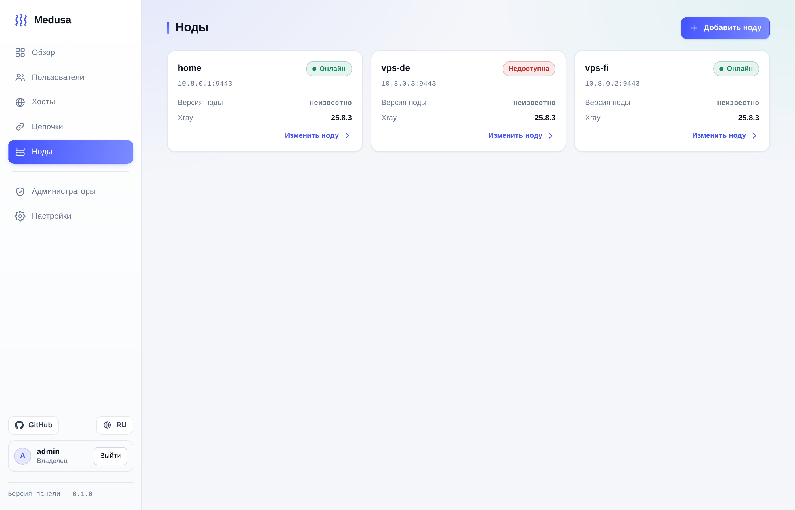
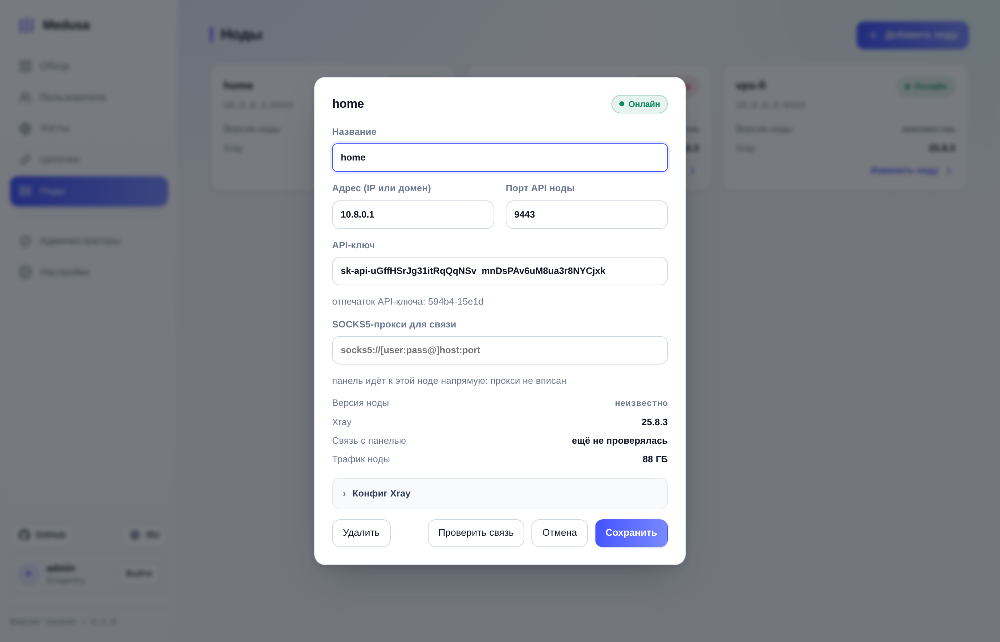
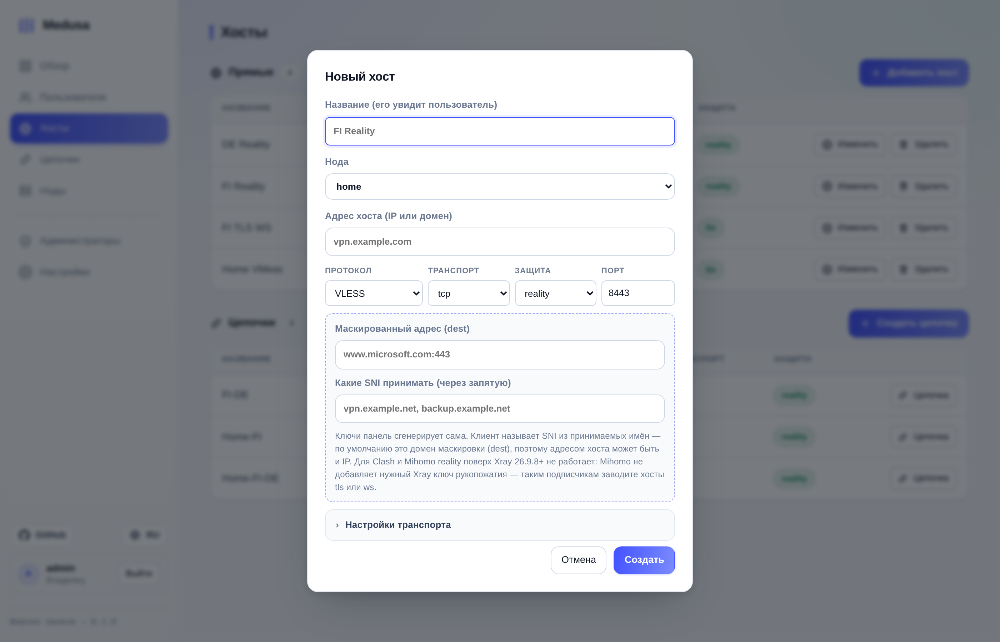
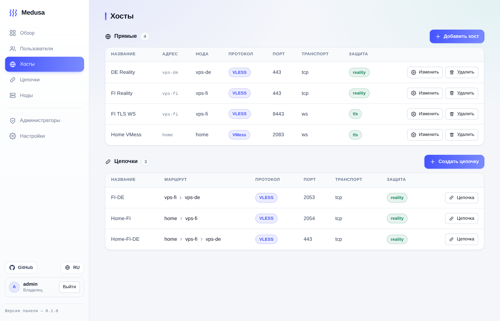
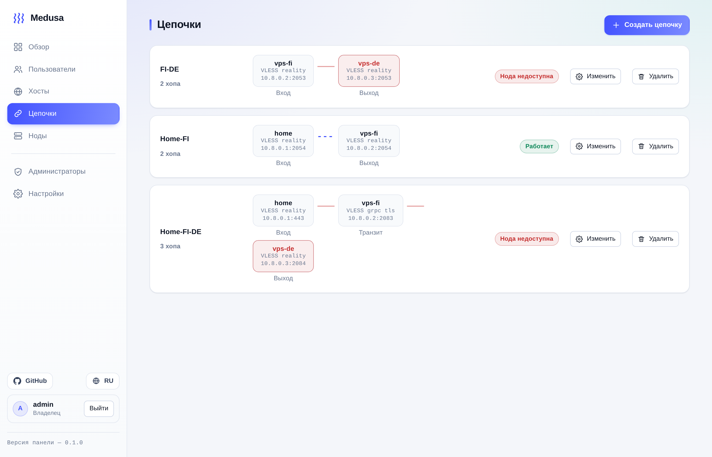
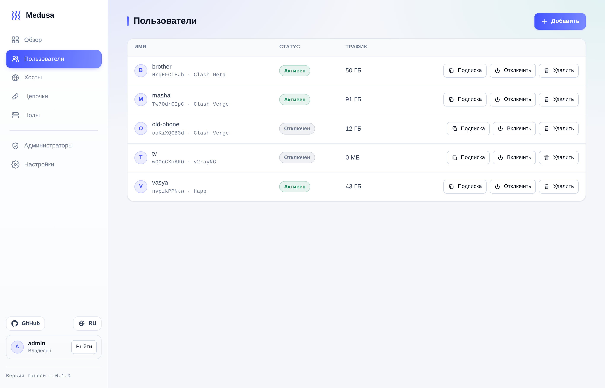
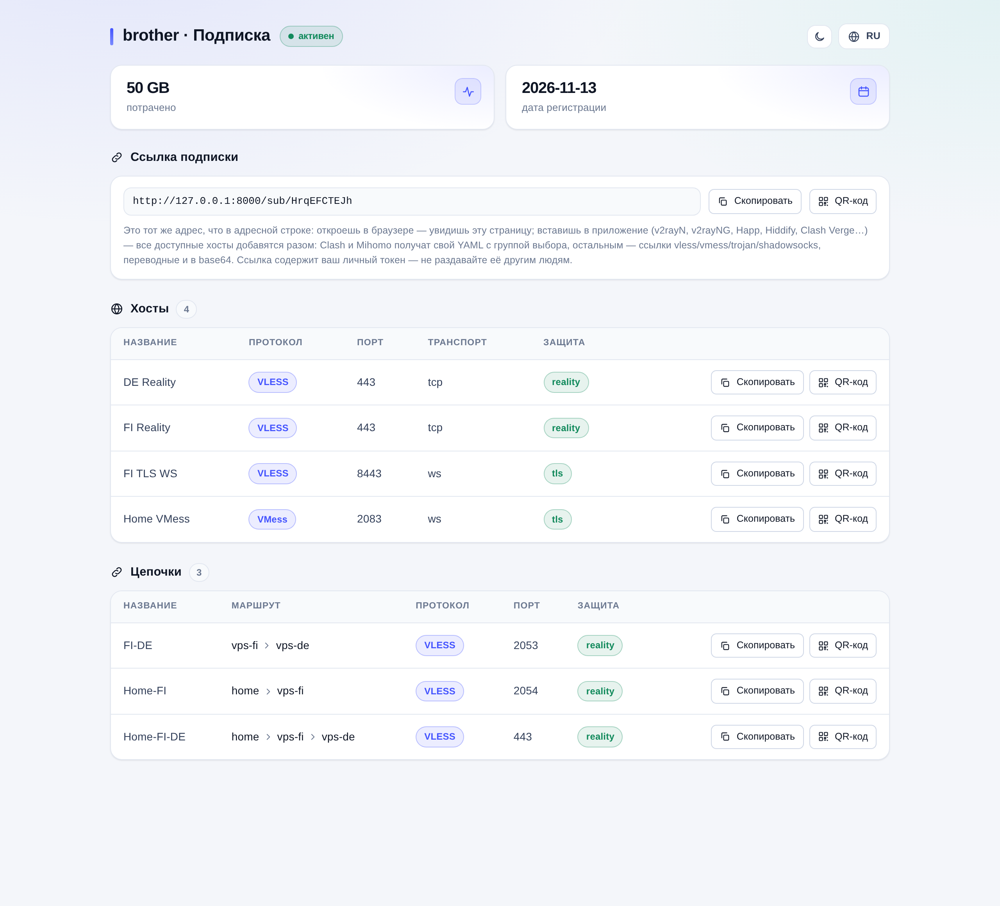

# Medusa

**Панель управления своими прокси-нодами.** У каждого пользователя появляется своя страница
подписки и ссылки, которые вставляются в обычный прокси-клиент (v2rayNG, v2rayN, Hiddify,
Shadowrocket, Clash Verge, nekobox…).

* **несколько нод и цепочки между ними** — трафик может идти «домашняя нода → VPS → наружу»,
  человек при этом видит один хост;
* **учёт трафика по людям** — байты снимает Xray на ноде, панель раскладывает их по подписчикам;
* **страница подписки со своим токеном** — HTML для браузера, переводные ссылки для приложений,
  YAML для Clash-приложений, QR-коды;
* **учётки и роли** (владелец и администраторы), вход паролем и по аппаратному ключу (FIDO2).

```
подписчик ──▶ нода (Xray; конфиг собирает и присылает панель)
              ▲  HTTP + API-ключ, свой порт ноды (9443)
            панель  ──▶ браузер подписчика: /sub/<токен>
```

Хосты: протоколы **vless, vmess, trojan, shadowsocks**; транспорт `tcp`, `websocket`, `grpc`;
защита `none`, `tls`, `reality`.

---

## Установка

### docker-compose — панель и нода

Готовый пример в репозитории — [`deploy/docker-compose.yaml`](deploy/docker-compose.yaml):
там образы **собираются** из этого же репозитория, нода стоит на `network_mode: host`,
и есть тома для базы панели и состояния ноды.

```bash
docker compose -f deploy/docker-compose.yaml up --build -d
docker compose -f deploy/docker-compose.yaml logs panel        # пароль владельца
docker compose -f deploy/docker-compose.yaml logs node-home    # API-ключ ноды — его в панель
```

Если берёте готовые образы (каждый релиз публикуется в реестр `docker.sonoma.su`, версия —
из `pyproject.toml`), compose-файл можно положить прямо на сервере: панель и нода — обе на
host-сети. Ноде это нужно потому, что ей надо слушать и API-порт, и клиентские порты Xray,
a панели — потому что она ходит к ноде по её API-порту: пока панель в отдельном контейнере,
`127.0.0.1` в карточке ноды означает «сам контейнер панели» и связка не складывается.

```yaml
# docker-compose.yaml
services:
  panel:
    image: docker.sonoma.su/medusa/panel:latest
    network_mode: host                      # адрес ноды в панели тогда — просто 127.0.0.1
    # ports: ["8000:8000"]                  # вариант с изоляцией: вместо network_mode
    # extra_hosts: ["host.docker.internal:host-gateway"]   # и тогда адрес ноды в панели — host.docker.internal
    volumes: [medusa-panel:/data]
    environment:
      MEDUSA_ADMIN_USER: admin
      # MEDUSA_ADMIN_PASSWORD: "..."                     # без него панель напечатает пароль в лог
      MEDUSA_PANEL_HOST: "0.0.0.0"                       # слушать на всех интерфейсах
      # MEDUSA_PANEL_PORT: "8080"                        # если 8000 на машине занят другим
      # MEDUSA_PANEL_BASE: https://panel.example.com     # за TLS-прокси: нужно для входа по ключу
    restart: unless-stopped

  node:
    image: docker.sonoma.su/medusa/node:latest
    network_mode: host                    # API 9443 + порты Xray как есть
    volumes: [medusa-node:/var/lib/medusa-node]
    environment:
      MEDUSA_NODE_PORT: "9443"
      # MEDUSA_NODE_API_KEY: "sk-api-..."                # без него нода напечатает свой ключ в лог
    restart: unless-stopped

volumes:
  medusa-panel:
  medusa-node:
```

```bash
docker login docker.sonoma.su      # реестр закрытый: логин + пароль
docker compose up -d
docker compose logs panel node     # пароль владельца и API-ключ ноды
```

Панель — на `http://адрес-машины:8000`. В брандмауэре ноды откройте её API-порт (9443) и
позже — порты хостов. Ноду на **другой** машине запускают тем же compose-файлом (образ
`…/node`, `network_mode: host`), а образ удобнее собрать там, где нода и работает:
`docker build -f deploy/Dockerfile.node -t docker.sonoma.su/medusa/node .`

### docker run

```bash
docker run -d --name medusa-panel --restart unless-stopped \
  -p 8000:8000 -v medusa-panel:/data -e MEDUSA_ADMIN_USER=admin \
  docker.sonoma.su/medusa/panel:latest

docker run -d --name medusa-node --restart unless-stopped --network host \
  -v medusa-node:/var/lib/medusa-node -e MEDUSA_NODE_PORT=9443 \
  docker.sonoma.su/medusa/node:latest

docker logs medusa-panel     # пароль владельца     docker logs medusa-node  # API-ключ ноды
```

Порт панели меняется переменной (`-e MEDUSA_PANEL_PORT=8080 -p 8080:8080`). Если панель
запускаете так — отдельным контейнером с `-p`, то в карточке ноды нужен адрес, доступный
**панели**, а не браузеру: адрес хоста (`host.docker.internal`, если добавили
`--add-host=host.docker.internal:host-gateway`, или IP `docker0`), но не `127.0.0.1` —
из контейнера это сам контейнер.

### Вручную (без Docker)

Python 3.14 и [uv](https://docs.astral.sh/uv/):

```bash
uv sync
uv run medusa-panel          # панель: http://127.0.0.1:8000
uv run medusa-node           # нода: её API на http://127.0.0.1:9443
```

Нода работает с настоящим Xray; если его нет в `PATH` — `MEDUSA_XRAY_BIN=/usr/local/bin/xray`.
Без Xray нода поднимется и честно скажет панели «на ноде нет Xray».

| Переменная | Где | Что делает |
| --- | --- | --- |
| `MEDUSA_DB` | панель | путь к SQLite (`data/medusa.db`) |
| `MEDUSA_ADMIN_USER` / `MEDUSA_ADMIN_PASSWORD` | панель | владелец (без пароля — сгенерирует и напечатает в лог) |
| `MEDUSA_PANEL_BASE` | панель | публичный адрес панели; нужен за обратным прокси и для FIDO2 |
| `MEDUSA_PANEL_HOST` / `MEDUSA_PANEL_PORT` | панель | адрес и порт панели (`127.0.0.1:8000`); в образе — `0.0.0.0:8000`, порт меняется одной строкой в compose |
| `MEDUSA_NODE_PORT` / `MEDUSA_NODE_API_KEY` / `MEDUSA_XRAY_BIN` | нода | порт API, готовый ключ вместо генерируемого, путь к Xray |

Полный список — в [AGENTS.md](AGENTS.md).

---

## Как пользоваться

**1. Нода.** Поднимите ноду и возьмите её API-ключ из лога (`docker logs medusa-node`, он же
`uv run medusa-node --print-api-key`; ключ переживает перезапуск ноды). В панели: **Ноды →
Добавить ноду** — название, адрес сервера, порт API, ключ. Клик по карточке = окно правки +
«Проверить связь»; дальше статус обновляется сам (фоновый опрос, интервал в «Настройках»).
Для ноды за NAT есть поле **SOCKS5-прокси** (`socks5://[user:pass@]host:port` или просто
`host:port`) — оно касается только связи панели с API ноды, подписчикам он не нужен.

 

**2. Хосты.** **Хосты → Новый хост**: название (его увидит пользователь), нода, **адрес
хоста** — домен или IP, к которому подключается клиент (у ноды свой адрес, для связи с
панелью), протокол, транспорт, защита и порт. У выбранной защиты появляются её поля, у
транспорта — свёрнутый блок «Настройки транспорта»: `path`/Host-заголовок для `ws`, имя
сервиса для `grpc`, отпечаток клиента `fp`. reality маскируется под сайт (`dest` и
принимаемые SNI — обязателен домен), tls берёт `sni`, свои сертификаты или self-signed самой
ноды. Порты считаются занятыми по машине ноды: `409` назовёт, кем именно занят порт.

 

**3. Цепочки.** **Цепочки → Создать цепочку**: название и 2–6 хопов, у каждого — своя нода,
свой протокол/транспорт/защита/порт и свой адрес хоста. Человек видит цепочку как один хост
(её вход), панель сама поднимает инбаунд на каждой ноде и переходы между ними; правится и
удаляется цепочка только целиком.



**4. Подписчики.** **Пользователи → Новый пользователь**: имя и приложение. Токен подписки —
одновременно пропуск и идентификатор человека (uuid для vless/vmess, пароль для trojan и
shadowsocks), по нему Xray на ноде считает его байты.



Один адрес `/sub/<токен>` работает для всех: браузер получает страницу подписки (статус,
трафик, хосты и цепочки, кнопки «скопировать» и «QR-код»), Clash-приложения — YAML со
списком `proxies:` и группой выбора, остальные — base64 переводных ссылок (`vless://`,
`vmess://`, `trojan://`, `ss://`; `?raw=1` — без base64). Удобнее всего скопировать или
отсканировать **ссылку подписки** — все доступные хосты добавятся разом; отдельный QR есть
и у каждого хоста (`/sub/<токен>/qr/host/<id>`).



---

## Настройки и учётки

Настройки живут в базе (тема, RU/EN, интервал опроса нод, таймаут ответа, срок сессии, вход
по аппаратному ключу) и переживают перезагрузку и другой браузер. Учётки: владелец (один,
создан при первом запуске, изменить нельзя) и администраторы — они ведут ноды, хосты,
цепочки, пользователей и настройки, но не чужие учётки и не могут отключить самих себя;
пароль учётки меняет только её владелец. Вход ключом требует HTTPS или `localhost`.

## Что стоит знать заранее

* **Clash и reality поверх свежего Xray не работают** (не по вине панели): Xray-core 26.9.8+
  требует в ClientHello гибрид `X25519MLKEM768`, Mihomo его не добавляет. Reality работает с
  клиентами на ядре Xray (v2rayNG, v2rayN, Happ, Xray CLI); Clash-подписчикам заводите хосты
  `tls` или `ws`.
* **API ноды не шифруется**: ключ — аутентификация, а не TLS, и в конфиге ноде летают
  приватные ключи. Панель и нода — в одном закрытом сегменте (WireGuard/Tailscale) или за
  TLS-реверс-прокси.
* **tls-сертификаты на ноде самоподписанные**, «игнорировать неверный сертификат» современный
  Xray не разрешает — строгому клиенту называют отпечаток (`pinnedPeerCertSha256`).
* hysteria2 хостом не заводится; правил маршрутизации внутри ноды, кроме `freedom` наружу и
  перехода цепочки, нет. Hiddify и sing-box отдельного конфига не просят — понимают ссылки.
